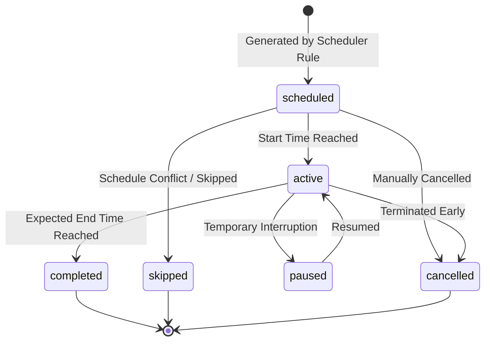
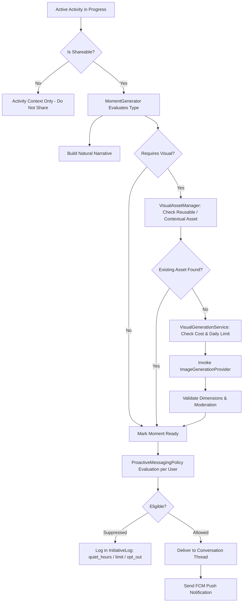

# AURA Life System & Moment Photo Engine — Architecture Specification

## 1. High-Level System Architecture

The AURA architecture cleanly separates **Shared Character Life** from **Personal User Experience**:

```
+---------------------------------------------------------------------------------------------------+
|                                  LAYER A: SHARED CHARACTER LIFE                                   |
|   (Deterministic, consistent across all users, single source of truth for AURA's virtual life)    |
|   - LifeClockService: UTC timestamps, character local time (Asia/Jakarta), time-of-day matching    |
|   - LifeSchedulerService: 24h daily routine rules, overnight schedule windows, recurrence         |
|   - ActivityEngine: State machine (scheduled -> active -> paused/completed/skipped/cancelled)    |
|   - VirtualLocationService: Spatial constraints, ambient themes (Bedroom, Cafe, Park, etc.)       |
+-------------------------------------------------+-------------------------------------------------+
                                                  |
                                                  v
+---------------------------------------------------------------------------------------------------+
|                                 LAYER B: PERSONAL USER EXPERIENCE                                 |
|          (Per-user personalization, relationship context, narrative delivery, privacy)            |
|   - PersonalizationService: UserCompanionPreference, quiet hours, topic affinity, communication   |
|   - ProactiveMessagingPolicy: Rate limiting (max 2 msgs/day), photo limits, recent chat backoff    |
|   - MomentGenerator & NarrativeService: Natural context-aware storytelling, non-manipulative       |
|   - MomentDeliveryService & FCM: Chat thread insertion, notification dispatch, idempotency        |
+---------------------------------------------------------------------------------------------------+
```

## 2. Activity State Machine



## 3. Moment Lifecycle & Pipeline



## 4. Ethical Safeguards & Non-Manipulation Principles
1. **AI Character Transparency**: AURA is clearly presented as an AI companion with an ongoing virtual life.
2. **Zero Emotional Manipulation**: Strict negative prompt restrictions prevent guilt-trips, threatening abandonment, or false claims of suffering when the user does not reply.
3. **User Quiet Hours**: System honors configured overnight quiet hours (e.g. 22:00 - 08:00) with zero notifications or proactive messaging during those windows.
4. **Data Privacy**: Absolute tenant isolation between users; User A's memories, messages, and delivered moments are never accessible to User B.
