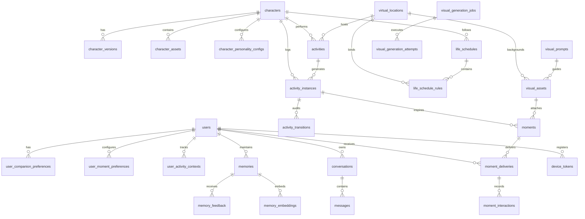

# Database Entity Relationship Diagram & Schema Specification

## 1. Mermaid Entity-Relationship Diagram

## 2. Table Specifications

### A. Character Domain
1. **`characters`**
   - `id`: UUID (Primary Key)
   - `name`: String, character display name (default: 'AURA')
   - `code`: String, unique identifier ('aura_main')
   - `gender_presentation`: String ('female')
   - `visual_style`: String ('2d_soft_anime')
   - `description`: Text
   - `metadata`: JSONB (eye color, hair style, primary palette)
   - `timestamps`

2. **`character_versions`**
   - `id`: UUID (PK)
   - `character_id`: UUID (FK -> characters)
   - `version_tag`: String (e.g. 'v1.0.0-placeholder')
   - `is_active`: Boolean
   - `release_notes`: Text
   - `timestamps`

3. **`character_assets`**
   - `id`: UUID (PK)
   - `character_id`: UUID (FK -> characters)
   - `version_id`: UUID (FK -> character_versions, nullable)
   - `asset_type`: String ('master_reference', 'placeholder', 'outfit')
   - `name`: String
   - `file_path`: String
   - `cdn_url`: String (nullable)
   - `approval_status`: Enum ('draft', 'pending_approval', 'approved', 'rejected')
   - `is_master_reference`: Boolean
   - `timestamps`

### B. Life System Domain
4. **`virtual_locations`**
   - `id`: UUID (PK)
   - `code`: String, Unique ('aura_bedroom', 'virtual_cafe', etc.)
   - `name`: String
   - `category`: String ('indoor', 'outdoor', 'commercial', 'public')
   - `description`: Text
   - `allowed_activities`: JSONB
   - `visual_theme`: String
   - `is_available`: Boolean
   - `timestamps`

5. **`life_schedules` & `life_schedule_rules`**
   - Manage 24-hour daily routine, day-of-week recurrence, time-of-day matching, and mood presentation.

6. **`activity_instances` & `activity_transitions`**
   - Audits state changes: `scheduled -> active -> completed / skipped / cancelled`.

### C. Moment & Visual Domain
7. **`moments`**
   - `id`: UUID (PK)
   - `character_id`: UUID (FK)
   - `activity_instance_id`: UUID (FK, nullable)
   - `visual_asset_id`: UUID (FK, nullable)
   - `moment_type`: Enum ('activity_moment', 'photo_moment', 'environment_moment', 'discovery_moment', 'reflection_moment', 'special_moment')
   - `title`: String
   - `narrative`: Text
   - `caption`: Text
   - `status`: Enum ('draft', 'evaluating', 'approved', 'generating', 'ready', 'delivered', 'failed', 'expired', 'cancelled')
   - `idempotency_key`: String (Unique)
   - `timestamps`

8. **`moment_deliveries` & `moment_interactions`**
   - Tracks per-user deliveries, conversation linkages, read status, likes, and feedback.

### D. User Personalization & Messaging
9. **`user_companion_preferences`**
   - `user_id`: Foreign Key (Unique)
   - `quiet_hours_start`: String ('22:00')
   - `quiet_hours_end`: String ('08:00')
   - `max_daily_proactive_messages`: Integer (default: 2)
   - `max_daily_photo_moments`: Integer (default: 1)
   - `photo_sharing_enabled`: Boolean (default: true)
   - `proactive_messaging_enabled`: Boolean (default: true)
   - `memory_enabled`: Boolean (default: true)
   - `timezone`: String ('Asia/Jakarta')
